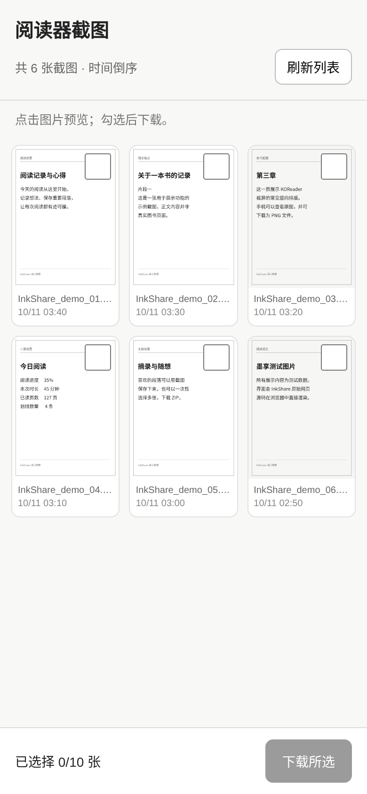
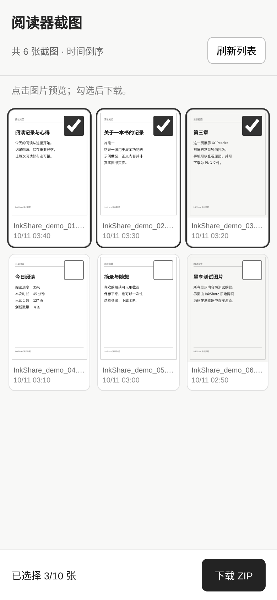
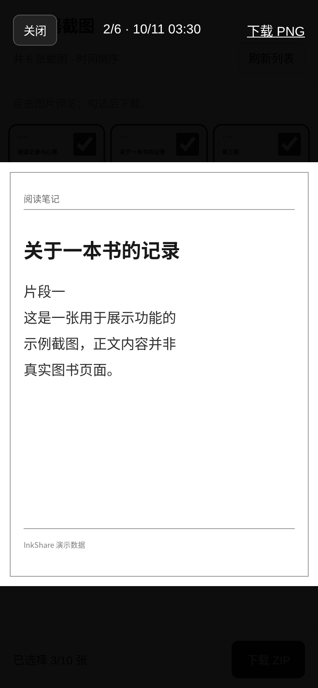

# 墨享 · InkShare

**KOReader 局域网截图分享插件。**

墨享（InkShare）是一个独立开发的 KOReader 插件。阅读器开启分享后，手机扫描二维码，即可在浏览器里查看历史截图、预览图片、选择并下载文件，无需电脑、云端服务或手机专用 App。

> **首个正式版本：v1.0.0。** 已在 **Kobo Sage + iPhone Safari** 上通过核心功能和网络稳定性实机验收。「关于墨享」及墨笺推荐也已通过实机验证。其他阅读器平台尚未获得实机验证。

## 功能

- 读取 KOReader 默认或用户自定义的截图目录，按修改时间倒序展示历史 PNG 截图。
- 手机网页显示缩略图；点击查看大图，左右滑动切换上一张 / 下一张。
- 单张下载原始 PNG，选择 **2～10 张**打包下载 ZIP；原始截图保留、不允许从手机删除或修改。
- 手机页面手动刷新截图列表，刷新时自动清空已勾选的项目。
- 阅读器显示二维码；关闭二维码后分享服务继续在后台运行。
- 手动停止分享或阅读器休眠后停止服务，唤醒后不会自动开启。
- 使用固定端口 `51423`，方便手机保存访问地址；阅读器 IP 地址变化后需要使用新地址。
- 分享期间协调 KOReader 的“闲置时关闭 Wi-Fi”功能；停止分享后恢复原有管理行为。
- 插件菜单提供「关于墨享」，显示作者与许可证信息，并推荐同作者项目「墨笺 · Inkfolio」，支持扫码查看其 GitHub 仓库。

## 界面预览（真实网页代码渲染）

下面三张图片由 **v1.0.0 插件中的 `page.lua` 原始 HTML / CSS / JavaScript** 在 Chromium 浏览器中渲染，未重新设计界面样式。列表中的图像和文件名为**演示数据**，不是真实用户的图书截图。无 Safari 浏览器外框。

### 截图列表



### 勾选后批量下载



### 单张预览



阅读器端「二维码」使用 KOReader 原生 `QRMessage`，而「关于墨享」使用原生 `ButtonDialog`。目前未取得两者的发布版本实机截图，因此暂不使用模拟设备照片展示。准确的菜单内容可参阅插件源码 `inkshare.koplugin/main.lua`。

## 设备与兼容性

| 环境 | 验证情况 |
| --- | --- |
| Kobo Sage（KOReader） | 已通过实机验收 |
| iPhone Safari（作为接收设备） | 已通过实机验收 |
| 其他 Kobo 机型 | 尚未实测 |
| Kindle / PocketBook / Cervantes / reMarkable | 尚未实测；部分机型可能存在网络、防火墙或休眠差异 |
| Android 系统的 KOReader 阅读器 | 不在项目支持范围内 |
| Android 手机浏览器（作为接收设备） | 设计上使用标准网页，但尚未实测 |

**当前公开描述应以“已在 Kobo Sage 验证”为准。** 其他非 Android 阅读器属于后续兼容目标，不等于已正式支持。

## 安装

1. 从 GitHub Releases 下载 `InkShare-v1.0.0.zip`，解压后找到 `inkshare.koplugin` 文件夹。
2. 将此文件夹复制到 KOReader 的 `plugins` 目录。以 Kobo 为例：

   ```text
   .adds/koreader/plugins/inkshare.koplugin/
   ├── _meta.lua
   ├── gallery.lua
   ├── http.lua
   ├── main.lua
   ├── page.lua
   ├── runtime.lua
   └── wifi.lua
   ```

3. 完全退出并重新启动 KOReader。

不要把整个源码压缩包作为一个文件复制到 `plugins` 目录；KOReader 需要识别上面的 `.koplugin` 文件夹。

## 使用方法

1. 用 KOReader 原有的截屏方式生成截图；手机与阅读器连接同一局域网。
2. 打开 KOReader 的 **工具 → 更多工具 → 墨享（InkShare） → 开启截图分享**。
3. 必要时按 KOReader 提示连接 Wi-Fi；服务启动后用手机扫描二维码。
4. 在浏览器中打开截图列表，点击图片预览，左右滑动切换；勾选图片进行下载。
5. 单选下载 PNG，多选 **2～10 张**下载 ZIP；下载结果在手机浏览器的下载位置查看。
6. 关闭阅读器上的二维码不会关闭服务。结束时请返回插件菜单，选择 **关闭截图分享**。

如果网页没有出现新截图，点击 **刷新列表**。列表刷新会取消之前的勾选。

在 **墨享（InkShare）→ 关于墨享** 中可查看项目信息、墨笺（Inkfolio）推荐，以及其 GitHub 项目二维码。墨笺项目地址：https://github.com/zacharykim88/Inkfolio 。

## 网络与隐私

- 通过 HTTP 提供服务，**没有 HTTPS 和访问密码**。只建议在可信的私人局域网中使用。
- 服务在阅读器的全部网络接口上监听 `51423` 端口；任何能够访问该地址的设备都可能浏览和下载截图。请勿将此端口转发到互联网。
- 手机网页仅提供截图读取与下载接口，不支持上传、删除或编辑阅读器文件。
- 批量下载时会在 KOReader 数据目录临时生成 ZIP，正常下载后清理；插件再次成功启动时也会清理上次残留的临时 ZIP。
- 本插件不需要云账户，也不主动向外部云服务上传截图。

## 常见问题

**扫码后无法打开网页：** 检查阅读器和手机是否位于同一个允许设备互访的 Wi-Fi；访客 Wi-Fi 的“设备隔离”可能阻止访问。确认 KOReader 中的分享状态为“分享中”。

**关闭二维码后无法访问：** 关闭二维码本身不会停止服务；但阅读器休眠、手动关闭、退出 KOReader 等情况会停止分享。

**截图列表为空：** 先在 KOReader 内生成 PNG 截图，确认当前截图目录；手机点击“刷新列表”。隐藏的 macOS 附属文件不会被列为截图。

**批量下载失败：** 单次只支持选择 2～10 张截图；检查阅读器是否有足够的临时存储空间及 Wi-Fi 是否稳定。若问题持续，请保留操作步骤和 KOReader 日志。

**重连 Wi-Fi 后书签无法访问：** 阅读器可能获得了新 IP 地址。请在 KOReader 里重新显示二维码，使用新的地址。

## 技术说明

插件主体使用 Lua 和 KOReader 提供的插件、网络、二维码与归档接口。手机页面使用原生 HTML / CSS / JavaScript，不依赖第三方前端框架、数据库或手机 App。项目独立开发，没有直接以之前测试的第三方截图分享插件为修改基础。

KOReader 项目：https://github.com/koreader/koreader

## 开源许可证

墨享（InkShare）采用 **GNU Affero General Public License v3.0（AGPL-3.0-only）** 授权，许可证全文见 [LICENSE](LICENSE)。

你可以在许可证条件下使用、研究、修改和再分发本项目。公开提供网络服务或发布修改版本时，请遵守 AGPL-3.0 的相应源码提供、版权与许可告知要求。源码仓库：[github.com/zacharykim88/inkshare.koplugin](https://github.com/zacharykim88/inkshare.koplugin)。用户可通过该仓库获取完整源码和许可证。

**版权署名：Copyright (C) 2026 zacharykim88。** 所依赖的 KOReader 及第三方组件保留各自的版权与许可。

## 开发状态

**v1.0.0** 是墨享（InkShare）的首个正式版本，Kobo Sage + iPhone Safari 已通过实机验收；其他平台尚待验证。许可证为 AGPL-3.0-only，版本变更记录见 [CHANGELOG.md](CHANGELOG.md)。